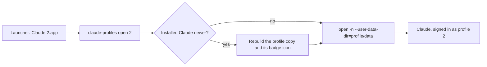

<div align="center">

# claude-profiles

**Two Claudes. Two accounts. One Mac. Zero logging out.**

Work Claude on the left. Personal Claude on the right. Both open, both live, both signed in.

One shell script. No installer, no dependencies, nothing to compile.

An open source side project by [Cosimo Franco](https://github.com/francoCosimo95). Contributions welcome.

[](https://github.com/francoCosimo95/claude-profiles/actions/workflows/ci.yml)
[](LICENSE)

[](#faq)


[Quick start](#quick-start) · [Commands](#commands) · [How it works](#how-it-works) · [FAQ](#faq) · [Roadmap](#roadmap) · [Contributing](CONTRIBUTING.md)

<picture>
  <source media="(prefers-color-scheme: dark)" srcset="docs/hero-dark.svg">
  
</picture>

</div>

## Why

Claude for Mac keeps one login. If you have a work account and a personal one, you sign out and back in all day, and you lose your place every time.

I built this for myself, because I live exactly that double life. Now each account gets its own app, its own number and its own color. If you do too, it is yours.

## Quick start

```bash
git clone https://github.com/francoCosimo95/claude-profiles.git
cd claude-profiles
./claude-profiles add
./claude-profiles add
```

That is it: you now have **Claude 2** and **Claude 3** next to your regular Claude. Open them from Spotlight or Launchpad, sign in once, done. The login sticks.

To use the command from anywhere:

```bash
mkdir -p ~/.local/bin
cp claude-profiles ~/.local/bin/
```

| **Easy** | **Tiny** | **Native** | **Safe** | **Fast** |
|---|---|---|---|---|
| Just `add`. No names, no config. | One bash script. No dependencies. | Only tools that ship with macOS. | Your original Claude is never touched. | A new profile is ready in about a second. |

## Built for people with more than one Claude

- **Work and personal.** The reason it exists.
- **Consultants and freelancers** with a separate account for each client or company.
- **Anyone who wants clean separation** between what lives in one account and what lives in another.

## What you get

- **A separate login for every profile.** Each one has its own data folder, so accounts never mix.
- **A real app for each one.** `Claude 2.app` shows up in Spotlight and Launchpad like anything else.
- **A colored badge on the icon.** Blue 2, green 3, purple 4... you know which window is which before you even look.
- **Always up to date.** Opening a profile checks your installed Claude first and rebuilds its copy if yours is newer.
- **Practically free on disk.** Copies are APFS clones, so a new profile starts out using almost no extra space.
- **Claude Code included.** `claude-profiles cli 2` gives your terminal a separate login per profile too.

## Commands

Profiles are numbered. Your regular Claude is the first one, so profiles start at 2.

| Command | What it does |
| --- | --- |
| `claude-profiles add [number]` | Create a profile: the next free number, or the one you give |
| `claude-profiles open <number>` | Open a profile, updating it first if needed |
| `claude-profiles list` | See your profiles, their versions and what is running |
| `claude-profiles update [number] [--force]` | Refresh profile copies from your installed Claude |
| `claude-profiles remove <number> [--keep-data]` | Delete a profile, including its login and data |
| `claude-profiles cli <number> [args...]` | Run the Claude Code CLI with the profile's own login |

`add` always takes the lowest free number. Have 2 and 4, delete 4, add again, and you get 4 back. Have 2 and 4, and `add` gives you 3.

```
$ claude-profiles list
PROFILE   VERSION      STATE
2         4.4212.0     running
4         4.4212.0     closed
$ claude-profiles add
Profile 3 is ready.
```

## Every profile gets its own color

The number on the badge decides the color.

<p align="center">
  
</p>

After 9 the cycle starts over, so 10 is blue again.

## Claude Code in the terminal

```bash
claude-profiles cli 2
```

It starts the `claude` command with `CLAUDE_CONFIG_DIR` pointing inside the profile, so your terminal login stays separate too. Arguments pass straight through: `claude-profiles cli 2 --help`.

## How it works

Claude is an Electron app, and Electron keeps its state in a "user data" folder you can choose with `--user-data-dir`. The catch: macOS opens only one instance of an app, unless you ask for a new one with `open -n`.



For each profile, `claude-profiles`:

1. **Copies** `Claude.app` into `~/.claude-profiles/profiles/<number>/` as an APFS clone.
2. **Opens** that copy with `open -n --user-data-dir=<profile>/data`, so it gets its own login and settings.
3. **Badges** the copy with a custom icon, set through Finder metadata (the same thing "Get Info" does when you paste an icon).
4. **Launches** through a tiny app that calls the script. Every start compares your installed Claude with the copy, and rebuilds the copy first when yours is newer.

Your original Claude is never touched, and neither is the inside of the copy, so its code signature stays valid. That is on purpose: in testing, copies with an edited app bundle (name, icon file, bundle id) crashed at startup, while an untouched copy ran fine.

```
/Applications/Claude.app                  your Claude, never modified
~/.claude-profiles/
  bin/claude-profiles                     runtime used by the launchers
  profiles/2/
    Claude.app                            APFS clone of your Claude
    data/                                 this profile's login and settings
    cli/                                  this profile's Claude Code config
    icon.icns                             the badged icon
~/Applications/Claude 2.app               launcher
```

## Status

Early and small, but it works. What it relies on:

- **How Claude's app is built today** (Electron and `--user-data-dir`). A future version of the app could change that.
- **APFS clones** for speed and disk space. On other volumes it falls back to a plain copy.

Tested on an Apple Silicon Mac. Nothing in it is specific to Apple Silicon, but Intel is unverified, and reports are welcome.

## FAQ

**Is my existing Claude safe?**
Yes. The script only reads `/Applications/Claude.app` to make copies. Your original app and its data stay exactly as they are.

**Is every profile a full copy of the app?**
It looks like one, but on APFS (the default on every recent Mac) the copy is a clone that shares disk blocks with the original. When Claude updates and a profile is rebuilt, it becomes a clone of the new version.

**Do profiles update themselves?**
Opening one from its launcher checks your installed Claude first and rebuilds when yours is newer. A profile that is already running is left alone until you close it. You can also run `claude-profiles update` any time.

**Why does the Dock still say "Claude"?**
The Dock label comes from the app's own metadata, and editing that breaks the app. The badge on the icon is how you tell instances apart.

**Where do my logins live?**
In `~/.claude-profiles/profiles/<number>/data`, on your Mac. Nothing leaves your machine.

**What does it need?**
macOS and Claude desktop at `/Applications/Claude.app`. The script uses `bash`, `osascript`, `sips`, `iconutil`, `codesign` and `cp`, all part of macOS. That is why the dependency count is zero.

**How do I remove a profile, or everything?**

```bash
claude-profiles remove 2
```

That deletes the launcher, the app copy and the login and data of profile 2. Add `--keep-data` to keep the login, so adding 2 again brings it right back. To remove everything:

```bash
rm -rf ~/.claude-profiles ~/Applications/Claude\ [0-9]*.app
```

## Roadmap

Ideas, in no particular order. Want one? Open an issue and say so, so nobody does the same work twice.

- [ ] Homebrew tap, for `brew install`
- [ ] `claude-profiles doctor`, to check what is wrong with a profile
- [ ] Shell completions
- [ ] Verified Intel support
- [ ] Tests that run in CI

## Contributing

This is open source and open to everyone. Bug reports, ideas, docs and pull requests are all welcome. Start with [CONTRIBUTING.md](CONTRIBUTING.md), and run the end to end test with:

```bash
./tests/smoke.sh
```

It uses a fake Claude app in a temp folder, so your real Claude and your real profiles are never touched.

## Disclaimer

This is a personal project and an unofficial community tool. It is not affiliated with or endorsed by Anthropic. "Claude" is a trademark of Anthropic.

It is meant for people who legitimately use more than one account, like a work account and a personal one. Use it in line with the terms of the services you sign in to. It does not copy or redistribute anything: each copy is made on your own Mac from the app you installed.

## License

MIT, see [LICENSE](LICENSE). Security issues: see [SECURITY.md](SECURITY.md).
