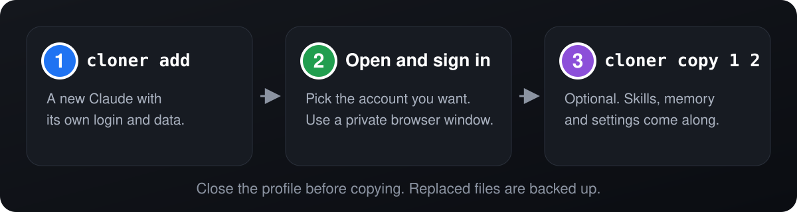
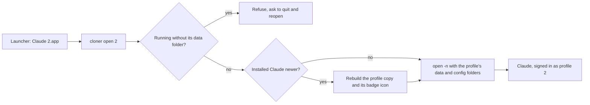

<div align="center">

# claude-cloner

**Two Claudes. Two accounts. One Mac. Zero logging out.**

Work Claude on the left. Personal Claude on the right. Both open, both live, both signed in.

One shell script. No installer, no dependencies, nothing to compile.

An open source side project by [Cosimo Franco](https://github.com/francoCosimo95). Contributions welcome.

[](https://github.com/francoCosimo95/claude-cloner/actions/workflows/ci.yml)
[](LICENSE)

[](#faq)


[The process](#the-process-add-then-copy) · [Quick start](#quick-start) · [Commands](#commands) · [Troubleshooting](#troubleshooting) · [How it works](#how-it-works) · [FAQ](#faq) · [Contributing](CONTRIBUTING.md)

<picture>
  <source media="(prefers-color-scheme: dark)" srcset="docs/hero-dark.svg">
  
</picture>

</div>

## Why

Claude for Mac keeps one login. If you have a work account and a personal one, you sign out and back in all day, and you lose your place every time.

I built this for myself, because I live exactly that double life. Now each account gets its own app, its own number and its own color. If you do too, it is yours.

## The process: add, then copy

Two steps, and the second is optional.

<p align="center">
  
</p>

1. **`cloner add`** makes a new Claude with its own login and its own data. It takes the next free number, starting at 2. Your regular Claude is number 1.
2. **Open it and sign in** with the account you want for this profile.
3. **`cloner copy 1 2`** (optional) brings your skills, agents, commands and `CLAUDE.md` from your regular Claude into profile 2. Memory, settings and the rest are opt-in.

```bash
cloner add
cloner copy 1 2
```

> [!IMPORTANT]
> Close the profile before running `cloner copy`. It refuses to write into a running profile, and Claude would overwrite the files it is using.

## Quick start

```bash
git clone https://github.com/francoCosimo95/claude-cloner.git
cd claude-cloner
./cloner add
```

`add` prints what to do next. In short:

1. Open **Claude 2** from Spotlight or Launchpad.
2. Sign in with the account you want for this profile. The login sticks.
3. Optional: close it and run `./cloner copy 1 2`.

> [!WARNING]
> Signing in opens your browser, and your browser may already be signed in to claude.ai with your main account. It will approve that one, and the profile ends up on the wrong account. Open the sign-in link in a private window, or use "switch account" on the browser page.

> [!WARNING]
> Always open a profile from its launcher (`Claude 2`), or with `cloner open 2`. Do not start it from the Dock icon of a running copy: that starts it without its own data and it would use your regular Claude.

To use the command from anywhere:

```bash
mkdir -p ~/.local/bin
cp cloner ~/.local/bin/
```

| **Easy** | **Tiny** | **Native** | **Safe** | **Fast** |
|---|---|---|---|---|
| Just `add`. No names, no config. | One bash script. No dependencies. | Only tools that ship with macOS. | Your original Claude is never touched. | A new profile is ready in about a second. |

## Built for people with more than one Claude

- **Work and personal.** The reason it exists.
- **Consultants and freelancers** with a separate account for each client or company.
- **Anyone who wants clean separation** between what lives in one account and what lives in another.

## What you get

- **A separate login for every profile.** Each one has its own data folder, so accounts never mix.
- **A real app for each one.** `Claude 2.app` shows up in Spotlight and Launchpad like anything else.
- **A colored badge on the icon.** Blue 2, green 3, purple 4... you know which window is which before you even look.
- **Your setup, carried over.** `cloner copy` brings skills, agents, memory and settings along.
- **Practically free on disk.** Copies are APFS clones, so a new profile starts out using almost no extra space.
- **Claude Code included.** The Code tab and `cloner cli 2` use the profile's own configuration and login.
- **Safety nets.** Backups before anything is overwritten, and a warning when a profile runs on the wrong data.

## Commands

Profiles are numbered. Your regular Claude is the first one, so profiles start at 2.

| Command | What it does |
| --- | --- |
| `cloner add [number]` | Create a profile: the next free number, or the one you give |
| `cloner open <number>` | Open a profile, updating it first if needed |
| `cloner list` | See your profiles, their versions and whether they are running |
| `cloner update [number] [--force]` | Refresh profile copies from your installed Claude, and restore a lost badge icon |
| `cloner remove <number> [--keep-data]` | Delete a profile, including its login and data |
| `cloner copy <from> <to> [--only items] [--link] [--dry-run]` | Copy skills, agents, memory and more between Claude instances |
| `cloner cli <number> [args...]` | Run the Claude Code CLI with the profile's own login |

`add` always takes the lowest free number. Have 2 and 4, and `add` gives you 3. Delete 4 and add again, and you get 4 back.

```
$ cloner list
PROFILE   VERSION      STATE
2         4.4212.0     running
4         4.4212.0     closed
$ cloner add
Profile 3 is ready.
```

## Copy: bring your setup along

A new profile starts empty. `cloner copy <from> <to>` fills it with what you choose. `1` is your regular Claude, any other number is a profile.

```bash
cloner copy 1 2
cloner copy 1 2 --only skills,memory,settings
cloner copy 1 2 --dry-run
cloner copy 2 3 --only skills --link
```

Without `--only`, it copies the safe set: `skills`, `agents`, `commands` and `instructions`.

| Item | What it is | In the default set |
| --- | --- | --- |
| `skills`, `agents`, `commands` | The matching folders of your Claude Code configuration | Yes |
| `instructions` | Your `CLAUDE.md` | Yes |
| `hooks` | The `hooks` folder | No |
| `settings` | `settings.json`: permissions, hooks, environment | No |
| `memory` | Claude Code's per-project memory files | No |
| `mcp` | The desktop app's `claude_desktop_config.json` (can contain API keys) | No |

What to know before you run it:

- **Run it again to sync.** New and changed files overwrite the ones with the same name in the profile. It merges: a file you deleted from the source stays in the profile.
- **Backups.** Whatever gets replaced is saved in `.cloner-backup` inside the profile's configuration folder, with the time of the copy.
- **`--dry-run` writes nothing.** It only shows what would be copied. It works even if the profile is open.
- **`--link` keeps folders in sync.** Instead of copying, the profile points at the source folder. Changes show up on both sides, and removing the profile never deletes the source.
- **Never copied.** Login files (`.claude.json`, credentials), organization files (`policy-limits`, `remote-settings`), history and caches.
- **The profile must be closed.** Reopen it afterwards to load the changes.

> [!NOTE]
> **Memory comes in two kinds.** `cloner copy --only memory` copies Claude Code's memory, the files under `projects/*/memory` that the Code tab uses. The memory of the Claude chat is different: it belongs to the account on Anthropic's servers, so no tool on your Mac can copy it. Each account keeps its own.

> [!CAUTION]
> If one profile is for work and another is not, copying skills, instructions or memory carries that context across. Copy only what you want the other account to see.

## Every profile gets its own color

The number on the badge decides the color.

<p align="center">
  
</p>

After 9 the cycle starts over, so 10 is blue again.

## Claude Code in the terminal

```bash
cloner cli 2
```

It starts the `claude` command with `CLAUDE_CONFIG_DIR` pointing inside the profile, so your terminal login stays separate too. Arguments pass straight through: `cloner cli 2 --help`. The desktop app gets the same variable when it is opened from the launcher, which is why its Code tab has its own configuration.

## How it works

Claude is an Electron app, and Electron keeps its state in a "user data" folder you can choose with `--user-data-dir`. The catch: macOS opens only one instance of an app, unless you ask for a new one with `open -n`.



For each profile, `cloner`:

1. **Copies** `Claude.app` into `~/.claude-cloner/profiles/<number>/` as an APFS clone.
2. **Opens** that copy with `open -n --user-data-dir=<profile>/data` and `CLAUDE_CONFIG_DIR=<profile>/cli`, so it gets its own login, settings and Claude Code configuration.
3. **Badges** the copy with a custom icon, set through Finder metadata (the same thing "Get Info" does when you paste an icon).
4. **Launches** through a tiny app that calls the script. Every start compares your installed Claude with the copy, and rebuilds the copy first when yours is newer.

5. **Locks** the copy with the immutable flag, so Claude's own updater cannot replace it. Without the lock, an update restarted the copy without its data folder and without its badge, and signed you in as your main account. Profiles update through the launcher instead, see below.

Your original Claude is never touched, and neither is the inside of the copy, so its code signature stays valid. That is on purpose: in testing, copies with an edited app bundle (name, icon file, bundle id) crashed at startup, while an untouched copy ran fine.

```
/Applications/Claude.app                  your Claude, never modified
~/.claude-cloner/
  bin/cloner                              runtime used by the launchers
  profiles/2/
    Claude.app                            APFS clone of your Claude
    data/                                 this profile's login and settings
    cli/                                  this profile's Claude Code configuration
    icon.icns                             the badged icon
~/Applications/Claude 2.app               launcher
```

## Troubleshooting

| What you see | Why | What to do |
| --- | --- | --- |
| The profile is signed in as your main account | Your browser approved the account it was already signed in with | Sign out of the profile, then sign in again from a private browser window |
| Same thing, and `cloner list` says `running on wrong data` | The profile was started without its data folder, for example from the Dock icon, or by Claude's own updater in a copy made before 0.4.3 (newer copies are locked against that) | Quit it and open it again from its launcher (`Claude 2`, or `cloner open 2`) |
| The badge disappeared from the icon | Claude replaced the app copy, and the badge lives in the copy's metadata | Run `cloner update 2`, or `cloner open 2`. Both put it back. Restart the Dock with `killall Dock` if it still shows the old icon |
| `cloner copy` says the profile is running | It never writes into an open profile | Quit the profile and run it again |
| The Code tab does not show the copied skills | The profile was open while copying, or was not reopened | Quit the profile, run `cloner copy 1 2` again, then open it |
| Nothing from the Claude chat memory shows up | Chat memory belongs to the account, not to the Mac | Nothing can copy it, each account keeps its own |
| `cloner open` says the profile runs without its data folder | Same as above | Quit it first, then open it again |

## Status

Early and small, but it works. It was tested end to end on macOS 26 with an Apple Silicon Mac and Claude desktop 4.4212.0 and 4.23118.0: `add`, signing in, `copy` and seeing the copied skills in the Code tab. The automated tests run with `./tests/smoke.sh`.

What it relies on:

- **How Claude's app is built today** (Electron, `--user-data-dir` and `CLAUDE_CONFIG_DIR`). A future version of the app could change that.
- **APFS clones** for speed and disk space. On other volumes it falls back to a plain copy.
- **Claude updating its own copy.** Profile copies are locked so the updater cannot replace them. If the updater ever finds another way, `cloner list` flags the profile and `cloner update` restores the badge. A locked copy cannot be deleted from Finder: use `cloner remove`.

Intel Macs are unverified. Nothing in it is specific to Apple Silicon, and reports are welcome.

## FAQ

**Is my existing Claude safe?**
Yes. The script only reads `/Applications/Claude.app` and your Claude Code configuration to make copies. Your original app and its data stay exactly as they are.

**Is every profile a full copy of the app?**
It looks like one, but on APFS (the default on every recent Mac) the copy is a clone that shares disk blocks with the original. When Claude updates and a profile is rebuilt, it becomes a clone of the new version.

**Do profiles update themselves?**
Opening one from its launcher checks your installed Claude first and rebuilds when yours is newer. A profile that is already running is left alone until you close it. You can also run `cloner update` any time. Claude's own updater cannot replace a profile copy: `cloner` locks the copy, because an update used to restart it on your main account's data and wipe its badge. If your installed Claude is newer, the profile is rebuilt the next time you open it from its launcher. Copies made before 0.4.3 are locked the first time you open or update them.

**Why does the Dock still say "Claude"?**
The Dock label comes from the app's own metadata, and editing that breaks the app. The badge on the icon is how you tell instances apart.

**Where do my logins live?**
In `~/.claude-cloner/profiles/<number>/data`, on your Mac. Nothing leaves your machine.

**What does it need?**
macOS and Claude desktop at `/Applications/Claude.app`. The script uses `bash`, `osascript`, `sips`, `iconutil`, `codesign` and `cp`, all part of macOS. That is why the dependency count is zero.

**How do I remove a profile, or everything?**

```bash
cloner remove 2
```

That deletes the launcher, the app copy and the login and data of profile 2. Add `--keep-data` to keep the login, so adding 2 again brings it right back. To remove everything:

```bash
chflags -R nouchg ~/.claude-cloner
rm -rf ~/.claude-cloner ~/Applications/Claude\ [0-9]*.app
```

## Roadmap

Ideas, in no particular order. Want one? Open an issue and say so, so nobody does the same work twice.

- [ ] `cloner copy --mirror`, to also delete what no longer exists in the source
- [ ] Homebrew tap, for `brew install`
- [ ] `cloner doctor`, to check what is wrong with a profile
- [ ] Shell completions
- [ ] Verified Intel support

## Contributing

This is open source and open to everyone. Bug reports, ideas, docs and pull requests are all welcome. Start with [CONTRIBUTING.md](CONTRIBUTING.md), and run the end to end test with:

```bash
./tests/smoke.sh
```

It uses a fake Claude app in a temp folder, so your real Claude and your real profiles are never touched.

## Disclaimer

This is a personal project and an unofficial community tool. It is not affiliated with or endorsed by Anthropic. "Claude" is a trademark of Anthropic.

The Claude app icon in the images belongs to Anthropic. It is shown only to make clear what this tool works with.

It is meant for people who legitimately use more than one account, like a work account and a personal one. Use it in line with the terms of the services you sign in to. It does not copy or redistribute anything: each copy is made on your own Mac from the app you installed.

## License

MIT, see [LICENSE](LICENSE). Security issues: see [SECURITY.md](SECURITY.md).
