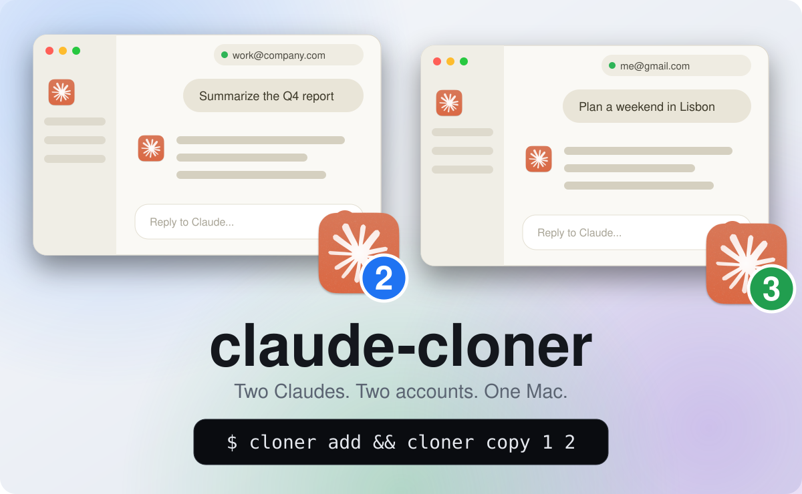
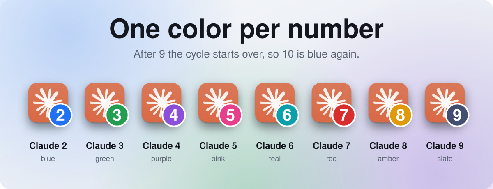

<div align="center">

# claude-cloner

**Two Claudes. Two accounts. One Mac.**

Run a second Claude desktop app next to your own, each signed in with a different account.
One shell script, nothing to install.

[](https://github.com/francoCosimo95/claude-cloner/actions/workflows/ci.yml)
[](LICENSE)

<picture>
  <source media="(prefers-color-scheme: dark)" srcset="docs/hero-dark.svg">
  
</picture>

</div>

## Why

Claude for Mac keeps one login. If you have a work account and a personal one, you sign out and back in all day, and lose your place every time.

claude-cloner gives each account its own app, with its own login, its own icon and its own color. I built it for myself. If you live the same double life, it is yours.

## Quick start

```bash
git clone https://github.com/francoCosimo95/claude-cloner.git
cd claude-cloner
./cloner add
```

Then open **Claude 2**, which is pinned in your Dock (you also find it in Spotlight, Launchpad and your Applications folder, right next to Claude), and sign in with the account you want. The login sticks.

If you also want your skills, instructions and memory in the new app, close it and run:

```bash
./cloner copy 1 2
```

`1` is your regular Claude, `2` is the new one. Run `./cloner add` again for a third.

> Signing in opens your browser, and your browser may already be signed in to claude.ai with your main account. It will approve that one. Use a private window, or switch account on the page.

## Commands

| Command | What it does |
| --- | --- |
| `cloner add [number]` | Make a new Claude and pin it in your Dock. Takes the next free number from 2, or the one you give. |
| `cloner open <number>` | Open it, updating it first if your installed Claude is newer. |
| `cloner list` | Show your profiles and whether they are running. |
| `cloner copy <from> <to>` | Copy skills, instructions and more from one Claude to another. |
| `cloner dock <number>` | Pin a profile's launcher in the Dock. `add` does it for you. |
| `cloner update [number]` | Refresh a profile from your installed Claude. |
| `cloner remove <number>` | Delete a profile, with its login and data. |
| `cloner cli <number>` | Run the `claude` command in the terminal with that profile's login. |

## Copying your setup

By default `copy` brings your skills, agents, commands and `CLAUDE.md`. Add what else you want with `--only`:

```bash
cloner copy 1 2 --only skills,memory,settings
cloner copy 1 2 --dry-run
```

The other items are `hooks`, `memory` (Claude Code's per-project memory), `settings` and `mcp`. A few things to know:

- Run it again any time to sync. New and changed files are copied over, and anything it replaces is saved in a `.cloner-backup` folder.
- `--dry-run` only shows what would be copied. `--link` makes a profile point at your folders instead of copying them.
- Login and organization files are never copied.
- Chat memory belongs to the account, so it cannot be copied. Each account keeps its own.
- The profile must be closed. Remember that copying between a work and a personal account carries that context across.

## Colors

Each number has its own color, so you know which window is which at a glance.

<p align="center">
  <picture>
    <source media="(prefers-color-scheme: dark)" srcset="docs/badge-colors-dark.svg">
    
  </picture>
</p>

## Good to know

- **Open profiles from their launcher.** `cloner add` pins it in your Dock for you (`--no-dock` skips that, `cloner dock 2` pins it later), and it is also `Claude 2` in Spotlight, or `cloner open 2`. Do not use "Keep in Dock" on the running icon: it pins the copy itself, which starts on your regular Claude's data. While a profile runs you will see two identical icons, the pinned launcher and the running app.
- **Claude cannot update a profile by itself.** The copy is locked, because an update once restarted it on the wrong account. `cloner open` rebuilds it when your installed Claude is newer. A locked copy cannot be deleted from Finder, so use `cloner remove`.
- **If a profile shows `running on wrong data`** in `cloner list`, quit it and open it again from its launcher. If its badge goes missing, `cloner update 2` puts it back.
- **Your original Claude is never touched.** Everything lives in `~/.claude-cloner`.
- **The Dock label stays "Claude".** The badge on the icon is how you tell them apart.

## How it works

Claude is an Electron app, and Electron keeps its state in a folder you can choose. macOS only opens one instance of an app, unless you ask for a new one. So for each profile, `cloner` makes an APFS clone of Claude.app (almost no extra disk space), gives it a badge icon, and opens it with its own data folder and its own Claude Code configuration. A small launcher app does that for you and checks for a newer Claude each time.

The copy is never edited inside, so its signature stays valid. In testing, copies with a modified bundle crashed at startup.

## Status

Stable since 1.0: the commands and options described here will not change in a breaking way within 1.x. Tested on macOS 26 on an Apple Silicon Mac with Claude desktop 4.4212.0 and 4.23118.0. Intel is unverified. It depends on how Claude's app is built today, and a future version could change that. The tests run with `./tests/smoke.sh`.

To remove everything: `chflags -R nouchg ~/.claude-cloner && rm -rf ~/.claude-cloner /Applications/Claude\ [0-9]*.app ~/Applications/Claude\ [0-9]*.app`

## Contributing

Bug reports, ideas and pull requests are welcome. See [CONTRIBUTING.md](CONTRIBUTING.md).

## Disclaimer

An unofficial personal project, not affiliated with or endorsed by Anthropic. "Claude" and its icon belong to Anthropic, and the icon appears here only to show what the tool works with. It is meant for people who legitimately use more than one account, like work and personal, within the terms of the services they sign in to. Nothing is redistributed: each copy is made on your own Mac from the app you installed.

## License

MIT, see [LICENSE](LICENSE). Security issues: [SECURITY.md](SECURITY.md).
