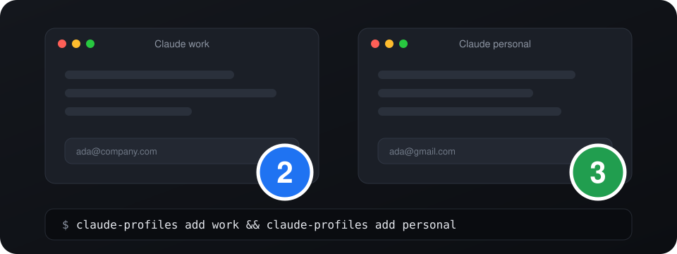

<h1 align="center">claude-profiles</h1>

<p align="center">
  <strong>Two Claudes. Two accounts. One Mac. Zero logging out.</strong>
</p>

<p align="center">
  <a href="LICENSE"></a>
  
  
  
</p>

<p align="center">
  
</p>

Work Claude on the left. Personal Claude on the right. Both open, both live, both signed in. No more logout, login, lose-your-place, repeat.

I built this for myself. I use Claude for work and for my own stuff, with two different accounts, and signing in and out all day was driving me crazy. So now each account gets its own app, its own icon and its own color. If you live the same double life, this is for you.

One shell script. No installer, no package manager, nothing to compile. It only uses tools that already ship with macOS.

## Set up in under a minute

```bash
git clone https://github.com/francoCosimo95/claude-profiles.git
cd claude-profiles
./claude-profiles add work
./claude-profiles add personal
```

Open **Claude work** or **Claude personal** from Spotlight or Launchpad, sign in once, done. The login sticks.

Want it available everywhere?

```bash
mkdir -p ~/.local/bin
cp claude-profiles ~/.local/bin/
```

## What you get

- **A separate login for every profile.** Work stays work, personal stays personal. Nothing mixes.
- **A real app for each one.** `Claude work.app` shows up in Spotlight and Launchpad like anything else.
- **A colored badge on the icon.** Blue 2, green 3, purple 4... you know which window is which before you even look.
- **Always up to date.** Open a profile and it checks your installed Claude first. New version? It rebuilds its copy for you.
- **Practically free on disk.** Copies are APFS clones. A new profile takes about a second and starts out using almost no extra space.
- **Claude Code included.** `claude-profiles cli work` gives your terminal a separate login per profile too.
- **Zero dependencies.** Just `bash` and what your Mac already has.

## Commands

| Command | What it does |
| --- | --- |
| `claude-profiles add <name> [--badge TEXT]` | Create a profile and its launcher app |
| `claude-profiles open <name>` | Open a profile, updating it first if needed |
| `claude-profiles list` | See your profiles, their versions and what is running |
| `claude-profiles update [name] [--force]` | Refresh profile copies from your installed Claude |
| `claude-profiles remove <name> [--purge]` | Delete a profile; `--purge` also wipes its login and data |
| `claude-profiles cli <name> [args...]` | Run the Claude Code CLI with the profile's own login |

```
$ claude-profiles list
NAME                 BADGE  VERSION      STATE
work                 2      4.4212.0     running
personal             3      4.4212.0     closed
```

## Every profile gets its own color

Numbers are assigned automatically, and each one comes with a color.

<p align="center">
  
</p>

After 9 the cycle starts over. Prefer a letter? `--badge W` takes up to two characters and picks its color from the same palette.

## Claude Code in the terminal

```bash
claude-profiles cli work
```

It starts the `claude` command with `CLAUDE_CONFIG_DIR` pointing inside the profile, so your terminal login stays separate too. Arguments pass straight through: `claude-profiles cli work --help`.

## Under the hood

Claude is an Electron app, and Electron keeps its state in a "user data" folder you can choose with `--user-data-dir`. The catch: macOS opens only one instance of an app, unless you ask for a new one with `open -n`.

For each profile, `claude-profiles`:

1. **Copies** `Claude.app` into `~/.claude-profiles/profiles/<name>/` as an APFS clone.
2. **Opens** that copy with `open -n --user-data-dir=<profile>/data`, so it gets its own login and settings.
3. **Badges** the copy with a custom icon, set through Finder metadata (the same thing "Get Info" does when you paste an icon).
4. **Launches** through a tiny app that calls the script. Every start compares your installed Claude with the copy, and rebuilds the copy first when yours is newer.

Your original Claude is never touched, and neither is the inside of the copy, so its code signature stays valid. That is on purpose: in testing, copies with an edited app bundle (name, icon file, bundle id) crashed at startup, while an untouched copy ran fine.

```
/Applications/Claude.app                  your Claude, never modified
~/.claude-profiles/
  bin/claude-profiles                     runtime used by the launchers
  profiles/work/
    Claude.app                            APFS clone of your Claude
    data/                                 this profile's login and settings
    cli/                                  this profile's Claude Code config
    icon.icns                             the badged icon
~/Applications/Claude work.app            launcher
```

## FAQ

**Is my existing Claude safe?**
Yes. The script only reads `/Applications/Claude.app` to make copies. Your original app and its data stay exactly as they are.

**Is every profile a full copy of the app?**
It looks like one, but on APFS (the default on every recent Mac) the copy is a clone that shares disk blocks with the original. When Claude updates and a profile is rebuilt, it becomes a clone of the new version.

**Do profiles update themselves?**
Opening one from its launcher checks your installed Claude first and rebuilds when yours is newer. A profile that is already running is left alone until you close it. You can also run `claude-profiles update` any time.

**Why does the Dock still say "Claude"?**
The Dock label comes from the app's own metadata, and editing that breaks the app. The badge on the icon is how you tell instances apart.

**Does it work on Intel Macs?**
Nothing in it is specific to Apple Silicon, but I have only tested it on an Apple Silicon Mac.

**Where do my logins live?**
In `~/.claude-profiles/profiles/<name>/data`, on your Mac. Nothing leaves your machine.

## Requirements

- macOS
- Claude desktop installed at `/Applications/Claude.app`

The script uses `bash`, `osascript`, `sips`, `iconutil`, `codesign` and `cp`, all part of macOS.

## Limitations

- The Dock label stays "Claude" (see the FAQ).
- It relies on how Claude's app is built today (Electron and `--user-data-dir`). A future version of the app could change that.
- Updates are applied when a profile is opened from its launcher, or with `claude-profiles update`.

## Uninstall

```bash
claude-profiles remove work --purge
claude-profiles remove personal --purge
rm -rf ~/.claude-profiles
```

`remove` without `--purge` deletes the launcher and the app copy but keeps the login and data, so adding the same name again brings the profile right back.

## Disclaimer

This is a personal project and an unofficial community tool. It is not affiliated with or endorsed by Anthropic. "Claude" is a trademark of Anthropic.

It is meant for people who legitimately use more than one account, like a work account and a personal one. Use it in line with the terms of the services you sign in to. It does not copy or redistribute anything: each copy is made on your own Mac from the app you installed.

## Like it?

If it saved you a few logouts, drop a star. Issues and ideas are welcome.

## License

MIT, see [LICENSE](LICENSE).
